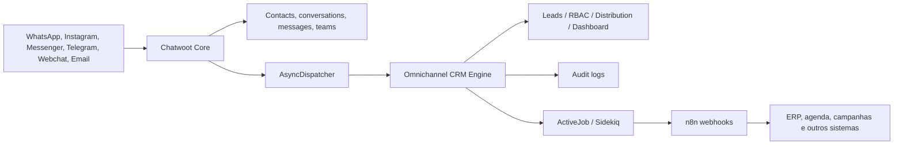

# Arquitetura

O núcleo Chatwoot é mantido intacto. A única integração no núcleo é o carregamento do gem local no `Gemfile` e o mount de rotas em `config/routes.rb`. O engine utiliza o dispatcher assíncrono já existente para observar eventos, sem callbacks adicionais em `Conversation`, `Message` ou `Contact`.



## Limites dos módulos

| Módulo | Responsabilidade | Fonte de verdade |
| --- | --- | --- |
| Chatwoot Core | canais, contatos, conversas, mensagens, notas, tags e equipes | tabelas nativas Chatwoot |
| CRM | lead, etapa comercial, valor e proprietário | `crm_leads` |
| RBAC | papel comercial e escopo de supervisor | tabelas `crm_role_*` e `crm_team_supervisors` |
| Automation | regras de evento e entregas | `crm_automation_rules` |
| n8n | conexão, execução e histórico | `crm_n8n_connections`, `crm_workflow_executions` |
| Dashboard | leitura agregada e escopo por perfil | Chatwoot + `crm_leads` |
| Audit | ações administrativas e eventos encaminhados | `crm_audit_logs` |

## Estrutura de pastas

```text
extensions/omnichannel_crm/
  app/controllers/omnichannel_crm/  # REST API
  app/listeners/omnichannel_crm/    # adaptador do dispatcher Chatwoot
  app/models/omnichannel_crm/       # entidades próprias
  app/services/omnichannel_crm/     # casos de uso e clientes externos
  app/jobs/omnichannel_crm/         # execução assíncrona
  config/routes.rb
  db/migrate/
  docs/
  lib/tasks/
```

## Eventos tratados

`conversation.created`, `message.received`, `message.sent`, `conversation.resolved`, `contact.created`, `lead.created`, `lead.converted`, `assignee.changed` e `conversation.status_changed` são normalizados para as regras de automação. Cada execução recebe um payload mínimo, é registrada antes do enfileiramento e mantém o resultado ou erro para auditoria.

## Princípios de atualização

- Nenhuma tabela nativa é alterada e não há monkey patch de modelos Chatwoot.
- O único prepend é no `AsyncDispatcher`, limitado a acrescentar um listener.
- Referências a entidades Chatwoot usam IDs, sem foreign keys entre os limites de produto.
- Atualizações do Chatwoot devem ser feitas primeiro em branch própria; depois, executar a suíte e uma smoke test dos eventos do engine.
