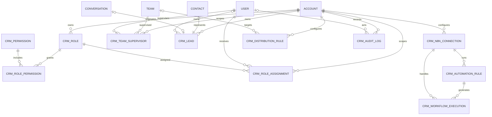

# Modelo ERD

As relações com `Account`, `User`, `Team`, `Contact` e `Conversation` são lógicas. O engine não cria chaves estrangeiras para tabelas do Chatwoot, reduzindo o acoplamento com migrações futuras do núcleo.
